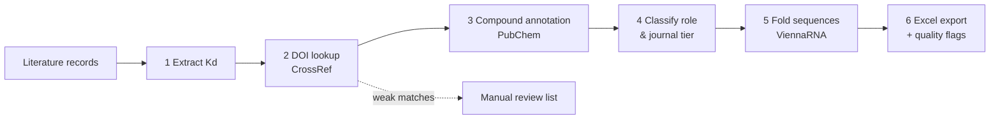

# Aptamer Curation Pipeline

**A reproducible Python workflow that turns published literature into a curated, annotated dataset of small-molecule-binding aptamers.**

  

Building an aptamer dataset from papers takes many manual steps: finding binding constants, checking references, identifying the target compounds, removing buffer and crystallisation artefacts, and characterising the sequences. This repository automates those steps in six modular stages, and it **flags uncertain entries for manual review instead of hiding them**.

> This is a clean, standalone demonstration of the workflow, run on a small example dataset. It is not tied to any specific database release.

---

## What it does

| # | Stage | What happens | Tools |
|---|---|---|---|
| 1 | **Binding-data extraction** | Finds Kd values in text and converts them to nM | regex, pandas |
| 2 | **DOI lookup & verification** | Looks up each paper on CrossRef, scores how closely the returned title matches, and sends weak matches to a review file | CrossRef REST API |
| 3 | **Compound annotation** | Adds PubChem CID, formula, molecular weight, SMILES, InChIKey | PubChem PUG-REST |
| 4 | **Classification** | Labels the ligand role (biological target / buffer / crystallographic additive) and the journal tier | configurable JSON rules |
| 5 | **Structure analysis** | Computes MFE structure, ΔG, GC %, base pairs and ensemble diversity, with DNA- and RNA-specific parameters | ViennaRNA (RNAfold) |
| 6 | **Export** | Writes a filterable, colour-coded Excel workbook plus a data-quality sheet | openpyxl |



---

## Installation

**Option A: conda (recommended, installs ViennaRNA cleanly)**
```bash
git clone https://github.com/AditiG475/aptamer-curation-pipeline.git
cd aptamer-curation-pipeline
conda env create -f environment.yml
conda activate aptamer-pipeline
```

**Option B: pip**
```bash
pip install -r requirements.txt
```

Optional but recommended: give CrossRef a contact email so it routes your requests to its "polite pool":
```bash
export CROSSREF_MAILTO="you@example.com"
```

## Quick start

```bash
./run_pipeline.sh                      # runs all six stages on data/example/entries.csv
./run_pipeline.sh my_entries.csv       # or on your own file
```

Results are written to `out/`; the final file is `out/curated_dataset.xlsx`.

Run a single stage:
```bash
python pipeline/s05_structure_analysis.py --input my.csv --output folded.csv --temperature 25
```

Run the tests (no internet needed; API calls are mocked):
```bash
python -m pytest -q
```

---

## Input format

A CSV with one row per aptamer–target entry:

| column | description |
|---|---|
| `entry_id` | your identifier |
| `target` | compound name (used for the PubChem lookup and the role classification) |
| `molecule_type` | `RNA` or `DNA` |
| `sequence` | aptamer sequence (5'→3') |
| `paper_title` | title of the source paper (used for the DOI lookup) |
| `journal` | journal name (used for the tier classification) |
| `year` | publication year |
| `binding_text` | the sentence or note that reports the binding constant |

See `data/example/entries.csv`.

## Output columns added

| Stage | Columns |
|---|---|
| 1 | `kd_value`, `kd_unit`, `kd_nM`, `kd_status` |
| 2 | `doi`, `crossref_title`, `title_similarity`, `doi_status` |
| 3 | `pubchem_cid`, `molecularformula`, `molecularweight`, `smiles`, `inchikey`, `pubchem_status` |
| 4 | `ligand_role`, `journal_tier` |
| 5 | `length`, `gc_content`, `mfe_structure`, `mfe_kcal_mol`, `base_pairs`, `ensemble_diversity`, `structure_status` |

Every stage writes a `*_status` column. The Excel export sums these on a `quality_flags` sheet, so you can see at a glance how many entries still need attention.

---

## Repository structure

```
aptamer-curation-pipeline/
├── pipeline/
│   ├── s01_extract_binding.py
│   ├── s02_doi_lookup.py
│   ├── s03_pubchem_annotate.py
│   ├── s04_classify.py
│   ├── s05_structure_analysis.py
│   └── s06_export_excel.py
├── config/classification_rules.json   # edit keywords & journal tiers here
├── data/example/entries.csv
├── tests/test_pipeline.py
├── run_pipeline.sh
├── requirements.txt / environment.yml
└── CITATION.cff
```

## Design choices

- **Flag, don't guess.** DOIs below a title-similarity threshold (default 0.85) are marked `needs_review` and also written to a separate file instead of being accepted. Compounds PubChem cannot find, and sequences with unexpected characters, are flagged the same way.
- **Rules live in config.** The classification keywords and the journal tiers are in a JSON file, so domain experts can change them without editing code.
- **Molecule-aware folding.** DNA aptamers are folded with the Mathews 2004 DNA parameters and RNA with Turner 2004. The folding temperature can be set to match the binding assay.
- **Polite API use.** Requests are rate-limited, repeated compound lookups are cached, and network errors are recorded per row instead of crashing the run.

## Limitations

- Kd extraction uses a regular expression. It finds the *first* Kd in each text field and does not read tables, figures, or ranges such as "10–50 nM".
- CrossRef matching is based on titles. Very short or generic titles can match the wrong paper; those should end up in the review file, but spot-checking is still advised.
- PubChem lookup by name can fail for trade names, abbreviations or mixtures.
- MFE structures are predictions. They do not model chemical modifications, G-quadruplexes, or how the structure changes when the target binds.
- **Example data:** the sequences and paper titles are real published aptamers, but the `binding_text` sentences are written for demonstration. Rows APT004–APT005 are made up to show the classification step. Do not reuse these Kd values as reference data.

## Citation

If this workflow helps your work, please cite it using [`CITATION.cff`](CITATION.cff).

## License

MIT © Aditi Ghosh
