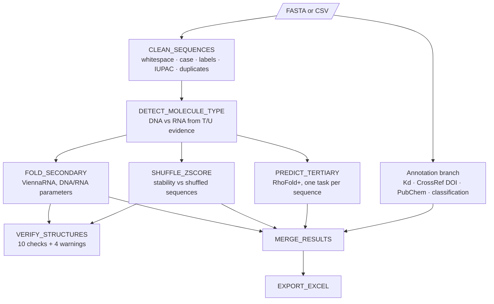

# Aptamer Curation Pipeline

**A Nextflow workflow that turns raw aptamer sequences and literature records into a clean, typed, structurally annotated dataset, with every questionable entry flagged instead of silently fixed.**

   

Sequences copied from papers are messy: line breaks, lowercase, 5′/3′ labels, position numbers, and DNA aptamers written in the same table as RNA ones. Folding them all as RNA, or skipping the clean-up, gives wrong energies. This workflow cleans the sequences, decides whether each one is DNA or RNA, folds each with the correct energy parameters, scores fold stability, can predict 3D models, checks its own results, and joins everything with literature and compound annotation.

---

## Workflow



| Step | Script (`bin/`) | What it does |
|---|---|---|
| Clean | `clean_sequences.py` | Joins multi-line FASTA, removes whitespace/tabs/line breaks, uppercases, strips 5′/3′ labels, numbers and gaps, removes non-IUPAC characters, flags duplicates and too-short/too-long sequences. Every change is logged in `clean_log`. |
| Detect type | `detect_molecule_type.py` | T only → DNA; U only → RNA; both → majority and flagged `mixed_T_and_U`; neither → declared `molecule_type` column or `--default_type` (flagged). A declared type that contradicts the sequence is flagged `declared_mismatch`. |
| Secondary structure | `fold_secondary.py` | MFE structure and energy with **Turner 2004 (RNA)** or **Mathews 2004 (DNA)** parameters, base pairs, GC %, free bases, loop count, terminal unpaired bases, ensemble diversity. |
| Z-score | `shuffle_zscore.py` | Compares the MFE with that of composition-preserving shuffles (default 30, seeded so results can be reproduced). Z < 0 means the sequence folds more stably than random sequences of the same composition. |
| 3D structure | `predict_tertiary.py` | Runs [RhoFold+](https://github.com/ml4bio/RhoFold) single-sequence prediction per aptamer, keeps the relaxed model and writes a summary. DNA is modelled as its RNA analogue and flagged `rna_analogue_of_dna`. |
| QC | `verify_structures.py` | Checks lengths, bracket balance, characters, free-base/loop/base-pair counts, MFE ≤ 0, finite Z-scores and shuffle counts, then warns on skipped folds, extreme MFE, Z > 0 and duplicates. |
| Annotation | `extract_binding.py`, `doi_lookup.py`, `pubchem_annotate.py`, `classify.py` | Kd extraction with conversion to nM; CrossRef DOI matching with a title-similarity check; PubChem properties via a CID → SMILES → InChIKey → name lookup order; ligand-role and journal-tier rules from `config/classification_rules.json`. |
| Report | `merge_results.py`, `export_excel.py` | One row per entry with every result, plus an Excel file containing a `quality_flags` sheet. |

---

## Installation

```bash
git clone https://github.com/AditiG475/aptamer-curation-pipeline.git
cd aptamer-curation-pipeline
conda env create -f environment.yml      # Nextflow + ViennaRNA + Python packages
conda activate aptamer-pipeline
```
Or use Docker (`docker build -t aptamer-curation-pipeline:2.0 .` and `-profile docker`).

**For 3D prediction (optional):** install RhoFold+ in its own environment by following its [README](https://github.com/ml4bio/RhoFold) and download the pretrained checkpoint. A GPU is strongly recommended.

## Usage

```bash
# Built-in test: a messy FASTA with whitespace, labels, numbering, mixed T/U and duplicates
nextflow run main.nf -profile test

# Your sequences (FASTA or CSV)
nextflow run main.nf --input my_aptamers.fasta --outdir results --temperature 25

# CSV with literature columns -> also runs Kd / DOI / PubChem / classification
export CROSSREF_MAILTO="you@example.com"
nextflow run main.nf --input data/example/entries.csv

# Add 3D models with RhoFold+
nextflow run main.nf --input my_aptamers.fasta --run_3d \
    --rhofold_dir /path/to/RhoFold --rhofold_ckpt /path/to/RhoFold_pretrained.pt \
    --rhofold_python /path/to/rhofold-env/bin/python -profile gpu

# Check the wiring of the whole workflow without running RhoFold+
nextflow run main.nf -profile test --run_3d --rhofold_dir x --rhofold_ckpt x -stub-run
```

Add `-resume` to rerun only the steps whose inputs changed. Run `nextflow run main.nf --help` to list all parameters.

### Input

- **FASTA**: the first word of each header becomes `entry_id`. Multi-line and messy sequences are fine.
- **CSV**: needs `entry_id` and `sequence` (column names can be changed with `--id_column` / `--seq_column`). An optional `molecule_type` column is used when the sequence alone can't decide. The annotation branch also uses `target`, `paper_title`, `journal` and `binding_text`, plus `cid` / `smiles` / `inchikey` if you have them.

### Key parameters

| Parameter | Default | Meaning |
|---|---|---|
| `--temperature` | 25 | folding temperature (°C); set it to your binding-assay temperature |
| `--shuffles` / `--seed` | 30 / 42 | Z-score shuffles and random seed |
| `--default_type` | RNA | type assumed when a sequence has no T or U and none is declared |
| `--min_length` / `--max_length` | 8 / 10000 | length limits for folding |
| `--run_3d` | false | run RhoFold+ |
| `--tertiary_max_length` | 200 | skip 3D prediction for longer sequences |
| `--skip_annotation` | false | skip the network-dependent annotation branch |
| `--strict` | false | stop the run if any QC check fails |

### Output (`results/`)

```
01_cleaned/cleaned.csv               cleaned sequences + clean_log
02_molecule_type/typed.csv           detected_type, type_evidence, type_flag
03_secondary_structure/secondary.csv structure, MFE, loops, ensemble diversity
04_zscore/zscore.csv                 Z-score and shuffle statistics
05_tertiary_structure/<id>_3d/       RhoFold+ PDB models + tertiary_summary.csv
06_qc/qc_checks.csv, qc_report.txt   pass / fail / warn for every check
07_annotation/annotated.csv          Kd, DOI, PubChem, classification
final_dataset.csv / .xlsx            everything joined on entry_id
pipeline_info/                       Nextflow run report and timeline
```

---

## Repository structure

```
├── main.nf                  workflow
├── nextflow.config          parameters, resources, profiles (conda, docker, gpu, test)
├── modules/                 one Nextflow process per step
├── bin/                     the Python scripts (Nextflow puts these on PATH automatically)
├── config/classification_rules.json
├── data/example/            aptamers_messy.fasta, entries.csv
├── tests/                   pytest suite (no internet needed)
├── environment.yml, requirements.txt, Dockerfile
└── CITATION.cff
```

Run the tests with `python -m pytest -q`.

## Design choices

- **Flag, don't guess.** Each step writes a status column (`clean_status`, `type_flag`, `fold_status`, `zscore_status`, `tertiary_status`, `doi_status`, `pubchem_status`, `kd_status`). A failed entry stays in the table with its reason.
- **DNA is folded as DNA.** Converting every sequence to RNA gives RNA energies for DNA aptamers. Here each molecule uses its own parameter set, and a test checks that switching between the two sets never leaks.
- **Parallel where it pays off.** The 2D fold and the Z-score run at the same time, and 3D prediction runs as one task per sequence with its own resource settings. A failed 3D model does not stop the run.
- **Reproducible.** Shuffles use a fixed seed, versions are pinned in the environment, Nextflow records a provenance report, and `-resume` skips steps that are already done.

## Limitations

- RhoFold+ is trained on RNA. 3D models of DNA aptamers are RNA analogues and only approximate. Modified nucleotides (2′-F, 2′-OMe, LNA) and G-quadruplexes are not modelled by ViennaRNA or RhoFold+.
- The Z-score uses mononucleotide shuffles. Dinucleotide-preserving shuffles are more conservative.
- When a sequence has no T or U, the DNA/RNA call relies on metadata or the default, and those rows are flagged.
- Kd extraction takes the first value it finds in free text. Values in tables, figures and ranges need manual curation.
- DOI matching is based on titles. Spot-check the `needs_review` list.
- **Example data:** the sequences and titles are real published aptamers, but the `binding_text` sentences are written for demonstration and some rows are made up to exercise the classification and cleaning steps. Do not reuse them as reference values.

## Citation

Please cite with [`CITATION.cff`](CITATION.cff) and cite the tools the workflow uses: Nextflow (Di Tommaso et al., 2017), ViennaRNA (Lorenz et al., 2011), RhoFold+ (Shen et al., 2024), CrossRef and PubChem.

## License

MIT © Aditi Ghosh
